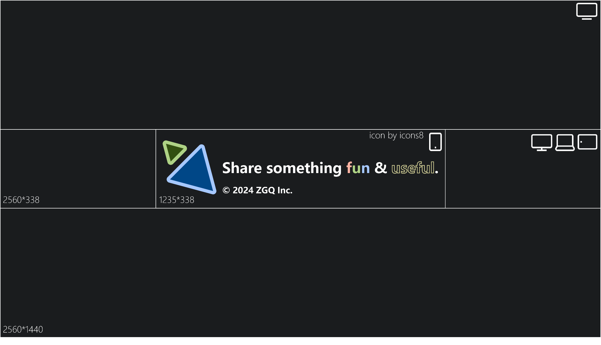

<!-- repos & tools used in this README -->
<!-- 
Adobe illustrator
https://github.com/DenverCoder1/readme-typing-svg
https://github.com/badges/shields
https://github.com/journey-ad/Moe-Counter
https://github.com/kittinan/spotify-github-profile
https://github.com/JeffreyCA/spotify-recently-played-readme
https://github.com/devicons/devicon/
https://www.pcgamebenchmark.com/
https://github.com/ZGQ-inc/skyline
https://github.com/ryo-ma/github-profile-trophy
https://github.com/yoshi389111/github-profile-3d-contrib
https://github.com/DenverCoder1/github-readme-streak-stats
https://github.com/anuraghazra/github-readme-stats
https://github.com/homarr-labs/dashboard-icons
https://github.com/gautamkrishnar/blog-post-workflow
-->

<h2 align="center">个人主页</h2>

  

<h2 align="center">个人TG频道</h2>

  

<h2 align="center">联系方式</h2>

  
  

<h2 align="center">个人博客</h2>

  

<table width="100%">
<!-- BLOG-POST-LIST:START --><tr><td width="26%" align="center" valign="top"> 🗓️ <code>2026-11-05</code></td><td width="74%" valign="top"><a href="https://blog.zgqinc.gq/posts/syshlp/"><b>移动终端预装系统级组件 SystemHelper 深度逆向分析与时空行为监控技术取证白皮书</b></a>  国家级/运营商级预装系统组件 SystemHelper &lpar;com.mobiletools.systemhelper&rpar; 深度逆向技术取证白皮书：横跨 4 年 5 代全量样本...</td></tr>
<tr><td width="26%" align="center" valign="top"> 🗓️ <code>2026-11-05</code></td><td width="74%" valign="top"><a href="https://blog.zgqinc.gq/posts/c8k3m9/"><b>教程：翻车与神级反转！以《The Classrooms》实战起底 Steam 物品强校验与资产层“后...</b></a>  硬核避坑与绝妙反转：解析为什么常规 SmokeAPI 会在强校验游戏中折戟？深度追踪《The Classrooms》内部的 SteamInventory 签名序列化拦截链...</td></tr>
<tr><td width="26%" align="center" valign="top"> 🗓️ <code>2026-11-04</code></td><td width="74%" valign="top"><a href="https://blog.zgqinc.gq/posts/ag140s/"><b>86 元官方支架平替！MINIWARE AirGo 140 3D 打印“双模自动休眠支架”开源实测...</b></a>  在完成了 MINIWARE AirGo 140 便携热风枪的深度硬核拆解后，面对官方单卖高达 86 元且存在‘枪头朝下余热倒灌烤化塑料/桌面’严重结构缺陷的原厂钣金支架，...</td></tr>
<tr><td width="26%" align="center" valign="top"> 🗓️ <code>2026-11-02</code></td><td width="74%" valign="top"><a href="https://blog.zgqinc.gq/posts/ag140d/"><b>全网首拆！MINIWARE AirGo 140 便携热风枪深度拆解与硬件架构全景分析 —— 140W...</b></a>  刚入手测试完 MINIWARE AirGo 140 便携热风枪，便难掩好奇心将其大卸八块！这大概是全网首个 AirGo 140 的深度硬核拆解。本文全面剖析其如何在仅 3...</td></tr>
<tr><td width="26%" align="center" valign="top"> 🗓️ <code>2026-10-31</code></td><td width="74%" valign="top"><a href="https://blog.zgqinc.gq/posts/pd31gw/"><b>全套 140W PD 3.1 EPR 桌面工作台达成 —— MINIWARE AirGo140 便携...</b></a>  时隔 8 个月，PD 供电便携热风枪的执念终于落地！405 元入手 MINIWARE AirGo 140，配合 193 元升级的菲尼瑞斯 HT-P1B 140W 加热台，...</td></tr>
<!-- BLOG-POST-LIST:END -->
</table>

<h2 align="center">访客数</h2>

<h2 align="center">Spotify正在播放</h2>

|  | |
|-|-|
 | 

<h2 align="center">语言和工具</h2>

 

<h2 align="center">个人设备</h2>

| | |
|-|-|
|                                                                    |     |

<h2 align="center">智能家居</h2>

-41BDF5?style=for-the-badge&logo=homeassistant&logoColor=FFFFFF)

%20%C2%B7%20%E6%8A%95%E5%BD%B1%E6%97%B6%E9%92%9F-41BDF5?style=for-the-badge&logo=homeassistant&logoColor=FFFFFF)
%20%E7%AA%97%E5%88%98%E6%9C%BA%E5%99%A8%E4%BA%BA-41BDF5?style=for-the-badge&logo=homeassistant&logoColor=FFFFFF)

<h2 align="center">DIY 设备</h2>

| 设备类型 | 品牌/型号 |
| :--- | :--- |
| **万用表/示波器/信号发生器** | 菲尼瑞斯 2D15P |
| **有线电烙铁** | 正点原子 T90B |
| **无线电烙铁** | 正点原子 TB1 |
| **电动螺丝刀** | 正点原子 S40P |
| **热风枪** | MINIWARE AirGo 140 |
| **热熔胶枪** | 安立信 JC250113 |
| **数控电源** | 菲尼瑞斯 DPS-150 |
| **供电基站** | 影器 CC700 + 长城 CRPS 1200W |
| **热成像** | 开源项目 UMEKOLAB |
| **电桥** | 菲尼瑞斯 LCR-ST2 |
| **晶体管测试仪** | 菲尼瑞斯 LCR-P1 |
| **逻辑分析仪** | 开源项目 NanoDLA |
| **电池充电器** | LiitoKala Lii-M4S |
| **点焊机** | 阿威兹 H2-2026 |
| **内阻测试仪** | 菲尼瑞斯 HRM-10 |
| **3D打印笔** | 无牌 OLED屏幕 |
| **3D打印机** | 拓竹 A1 mini |
| **电磨笔** | 米家 MJDMB001QW |
| **快充测试仪** | ChargerLab KM003C |
| **加热台** | 菲尼瑞斯 HT-P1B |
| **电子放大镜** | 未知品牌 TEMU台式 |
| **超声波切割刀** | 杰科美 JM-Y10 PRO |
| **测距仪/卷尺** | Aicevoos P7-60M |
| **游标卡尺** | 利华中天 不锈钢 |

<h2 align="center">开发环境</h2>

<h2 align="center">正在使用</h2>

 

<h2 align="center">个人Github成就</h2>

## [查看Github Skyline](https://skyline.zgqinc.gq/)

 

<h2 align="center">我在做的项目</h2>

## [blog.zgqinc.gq/posts/projects](https://blog.zgqinc.gq/posts/projects/)
